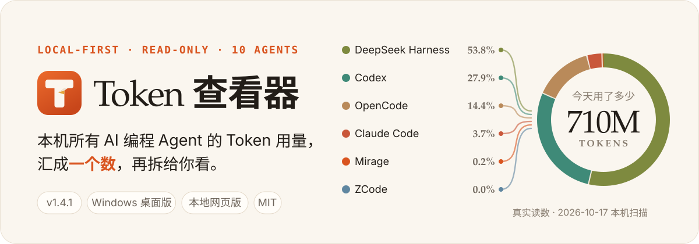
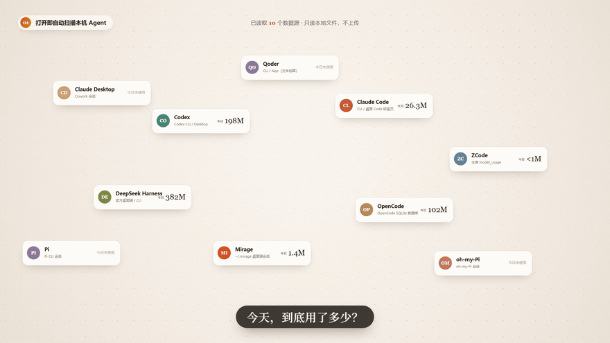
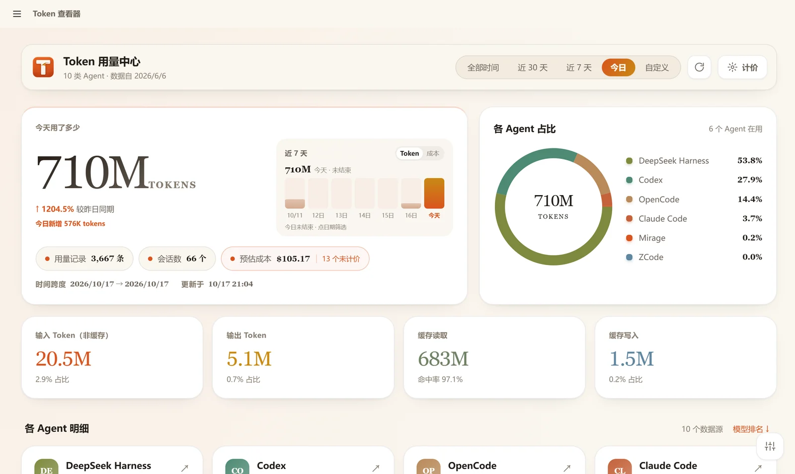
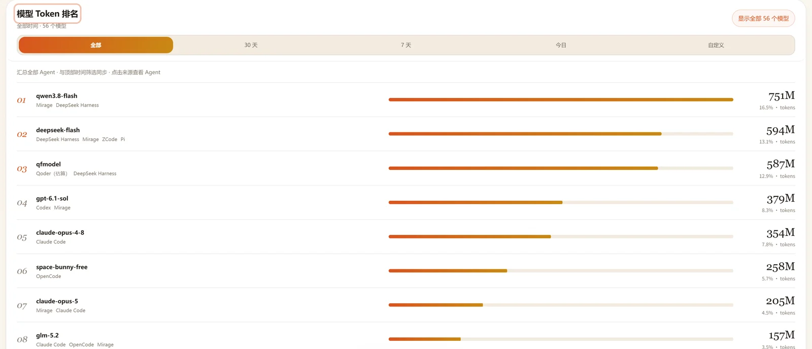

<p align="center">
  
</p>

<p align="center">
  <a href="https://github.com/kyoka-shuiyue/agent-token-viewer/releases/latest"></a>
  
  
  
  <a href="LICENSE"></a>
</p>

同时用 Claude Code、Codex、DeepSeek、OpenCode 这些 AI 编程工具时，每家只告诉你自己那一份。**Token 查看器**读取它们留在本机的会话记录，算出今天、这周、全部时间一共用了多少 Token，哪个工具、哪个模型用得最多，按你的单价大概花了多少钱。

<p align="center">
  
</p>
<p align="center"><sub>宣传片片段 · 完整 29 秒视频见 <a href="https://github.com/kyoka-shuiyue/agent-token-viewer/releases/latest">Release 附件</a></sub></p>

## 打开就能看到

<p align="center">
  
</p>

- **今天用了多少**：四类 Token 合计，和昨天同一时刻比较；近 7 天趋势可在 Token 与成本之间切换。
- **谁用得最多**：各 Agent 占比环图，图例和扇区联动；点卡片进入单个 Agent 的趋势、模型、每日热力和会话列表。
- **四类 Token 分开算**：非缓存输入、输出、缓存读取、缓存写入，另给出缓存命中率。
- **任意时间段**：全部时间、近 30 天、近 7 天、今日和自定义日期，切换立即重算。
- **估算成本**：给模型填四类单价（美元 / 每百万 Token），未计价的模型会明确提示，不当作 0。

<p align="center">
  
</p>

**模型排名**跨全部 Agent 按原始模型标识汇总，跟随顶部时间筛选；默认前 10 名，可展开全部，点来源可直接进入对应 Agent。

> 以上画面都是作者本机 2026-10-17 的真实扫描结果。

## 支持的 10 类 Agent

| Agent | 读取位置 | 备注 |
| --- | --- | --- |
| Claude Code | `~/.claude/projects/`、`~/.claude/stats-cache.json` | 含 CLI 与桌面端 Code 标签页；旧会话被清理的日期用官方按日统计补齐并标注 |
| Claude Desktop | 本地应用数据下的 `usage-ledger/*.ndjson` | Cowork 会话 |
| Codex | `~/.codex/sessions/`、`~/.codex/archived_sessions/` | 按线程去重，排除续聊重放和子 Agent 继承历史 |
| DeepSeek Harness | `~/.dsh`（可用 `DSH_HOME` 覆盖）与旧版桌面端目录 | 官方桌面端与 CLI，`session.v0–v4` 会话 |
| OpenCode | `~/.local/share/opencode/opencode.db` | 只读 SQLite |
| ZCode | `~/.zcode/cli/db/db.sqlite` 的 `model_usage` 表 | 只读 SQLite |
| Mirage | `~/.mirage/` | |
| Pi | `~/.pi/agent/sessions/` | |
| oh-my-Pi | `~/.omp/agent/sessions/` | |
| Qoder | `~/.qoder/projects/` | 本地不存 Token，**按消息文本估算**，界面会标注 |

完整的跨平台路径、字段位置和每个来源踩过的坑见 [docs/data-sources.md](docs/data-sources.md)，计量口径与去重规则见 [docs/units.md](docs/units.md)。

## 开始使用

### Windows 桌面版（推荐）

到 [Releases](https://github.com/kyoka-shuiyue/agent-token-viewer/releases/latest) 下载 `Token-Viewer-Setup-1.4.1-x64.exe`，双击安装即可。安装包自带 Electron 和 Node.js，**不需要另装运行环境，使用时不需要联网**。

- 打开后自动扫描本机数据源，首次约 5–15 秒，之后增量读取。
- 缓存和计价保存在 `%APPDATA%\Token Viewer\`，重启后保留；卸载不会删除这些个人数据。
- 安装包未做代码签名，Windows 可能提示“未知发布者”，选择“仍要运行”即可。校验值见 Release 里的 `SHA256.txt`。

### 网页版（Windows / macOS / Linux）

只需要 **Node.js ≥ 22.15**，不用安装任何 npm 依赖：

```bash
git clone https://github.com/kyoka-shuiyue/agent-token-viewer.git
cd agent-token-viewer
node server.js
```

浏览器会打开 <http://127.0.0.1:3457>。Windows 也可以双击 `start.bat`，macOS / Linux 用 `bash start.sh`。换端口：`TOKEN_VIEWER_PORT=3458 node server.js`（PowerShell 写成 `$env:TOKEN_VIEWER_PORT="3458"; node server.js`）。

### 只看命令行统计

```bash
node server.js --once      # 打印各数据源的记录数、Token 总量和主要模型
node server.js --doctor    # 自检：每个来源的候选路径是否存在、读到多少条
```

“暂无数据”时先跑 `--doctor`，能直接分清是没装、没用过，还是数据放在别处。

## 统计口径

各家的 `usage` 定义不一样，直接相加会算错。这里统一折算成四类：

```
总量 = 非缓存输入 + 输出 + 缓存读取 + 缓存写入
```

例如 Codex 的 `input_tokens` 已包含缓存命中，会拆成 `input − cached` 和 `cached`；流式回声、迁移副本、同一请求的多份记录都会去重，只保留最完整的一份。“用量记录”是去重后的记录条数，不等于 API 请求次数。

## 隐私

- 原始会话文件和数据库**只读**，不修改、不删除、不上传。
- 服务只监听 `127.0.0.1`；前端不加载 CDN、外部字体或统计脚本，断网可用。
- 本地缓存只含路径、时间、模型名、Token 数等计量字段，**不含对话正文、prompt 或密钥**，并已被 `.gitignore` 排除。
- 会话标题每次扫描时现读，不写入缓存。

## 已知限制

1. **成本是估算**：按你填写的单价折算，不能代替各家账单；模型名常是中转渠道自定义的，程序不猜价格。
2. **Qoder 的 Token 是估算值**：它本地不存 Token，本项目按消息文本长度估算，缓存读写固定为 0。
3. **Claude Code 会自己清理旧会话**：被删的日期只能用它的按日统计补总量，四类拆分按比例估算，界面会标注截止日期。
4. **桌面版目前只有 Windows**；网页版可在 macOS / Linux 运行。新的桌面端目录名如果不在候选路径里，欢迎补文档并提 PR。

## 从源码构建桌面版

```powershell
npm ci
npm run prepare:runtime   # 从 Node.js 官方下载 v22.22.3 并校验 SHA-256
npm run desktop           # 开发运行
npm test
npm run build:desktop     # 安装包输出到 dist/
```

Electron 44.7.0 与 electron-builder 26.15.3 固定在 `package-lock.json`。分发包只含应用文件，不含本机扫描缓存、私有计价或会话正文。

<details>
<summary>项目结构</summary>

```
server.js      扫描服务 + 10 个数据源适配器（零依赖）
index.html     界面（内联 CSS/JS，手写 SVG 图表）
desktop/       Electron 主进程、预加载脚本与桌面验收
scripts/       下载并校验内置 Node.js 运行环境
test/          node --test 自动测试
docs/          数据源图谱、计量口径、新增适配器指南
assets/readme/ README 图片（hero.svg 由 source/make_hero.py 生成）
```

</details>

## 更新记录与贡献

各版本改动见 [CHANGELOG.md](CHANGELOG.md)。最有价值的贡献是**补全数据源**：新增 Agent 适配器、修正某个平台上的路径差异、修正计量口径，流程见 [CONTRIBUTING.md](CONTRIBUTING.md) 与 [docs/adding-an-adapter.md](docs/adding-an-adapter.md)。

## 许可证

[MIT](LICENSE)
